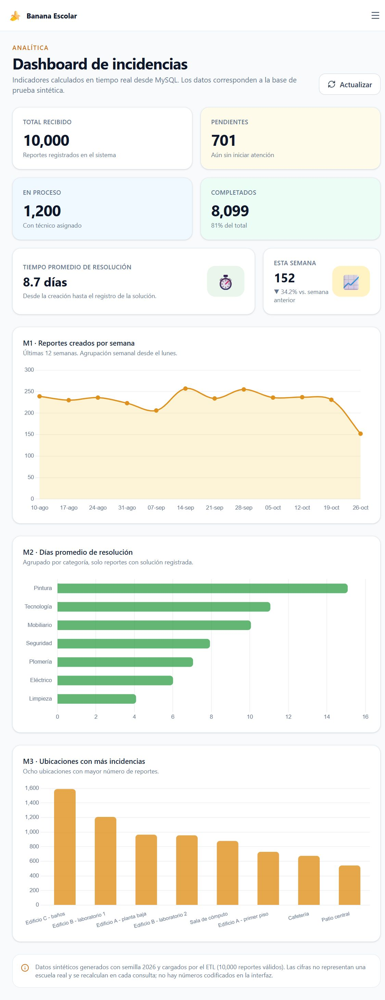
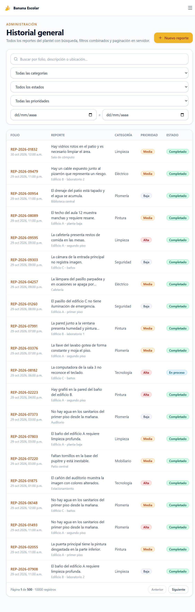
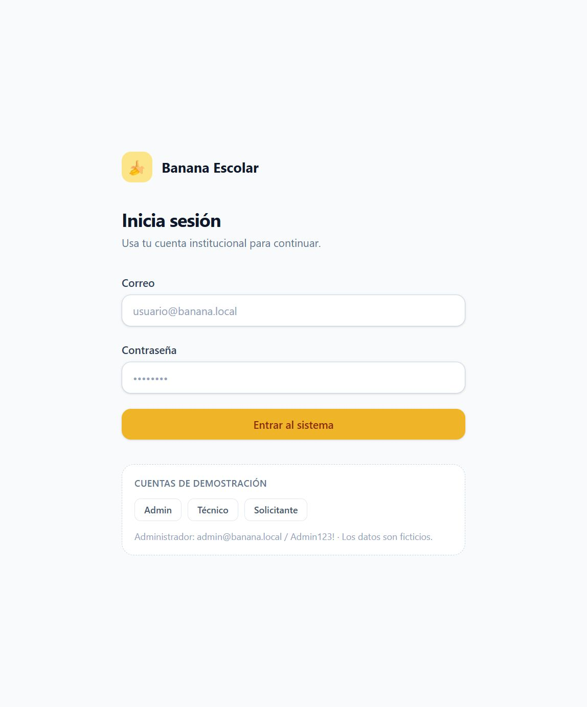
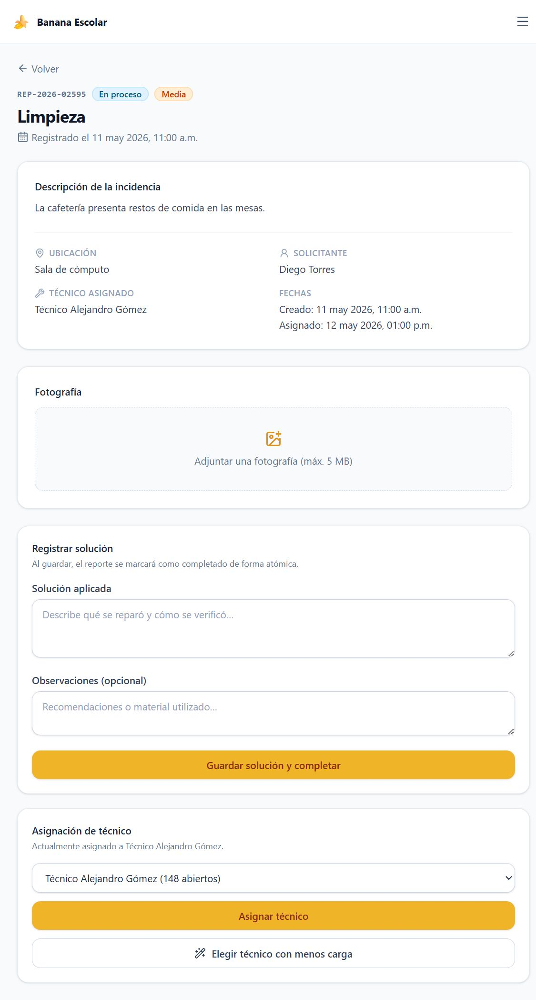

# Banana Escolar 🍌

Sistema de gestión y análisis de incidencias escolares. Monorepo con API NestJS,
web React, app Flutter, ETL reproducible y benchmark MySQL. Implementa las tres
entregas del proyecto: arquitectura y modelo de datos, ETL/base de prueba y
dashboard/benchmarking.

> **Datos 100 % ficticios.** La base de demostración se genera con semilla fija
> `2026`. No contiene información real de estudiantes ni personal.

## Stack

| Capa | Tecnología |
|---|---|
| Monorepo | pnpm workspaces + Turborepo (web, api, etl, benchmark, paquetes) |
| Web | React 19 + Vite + TypeScript + Tailwind CSS 4 |
| Estado/UI web | TanStack Query, React Router, React Hook Form, Zod, Chart.js |
| API | NestJS 11 + TypeScript, Swagger/OpenAPI |
| Base de datos | **MySQL 8.0+ / InnoDB / utf8mb4** |
| ORM | Prisma 6 (`mysql`) |
| ETL | Node.js + TypeScript + `csv-parse` + `mysql2` |
| Benchmark | Node.js + `mysql2`, `EXPLAIN ANALYZE` de MySQL |
| Móvil | Flutter + Dart, Riverpod, Dio, almacenamiento seguro |
| Pruebas | Jest (API/ETL), Vitest (web), Flutter test |

No se usa PostgreSQL, `ILIKE`, `pg_trgm`, GIN ni PgBouncer.

## Estructura

```text
apps/
  api/        NestJS + Prisma + migraciones + seed
  web/        React + Vite + dashboard
  mobile/     Flutter (no es paquete pnpm)
packages/
  api-client/ cliente TypeScript tipado compartido por web
  config-eslint/ config-typescript/
tools/
  etl/        generador, validación, carga y verificación
  benchmark/  seed 10k/1M, medición antes/después y planes
infra/
  mysql/      SQL, Docker opcional e instrucciones
  storage/    lineamientos de imágenes
docs/         arquitectura, base de datos, API, ETL, benchmark y entregables
```

## Requisitos

- Node.js **22+** (probado con 24)
- pnpm **10+** (`npm install -g pnpm`)
- MySQL **8.0+** local, MAMP compatible o instancia administrada
- Flutter **3.47+** solo si usarás la app móvil

## Puesta en marcha

### 1. Instalar dependencias

```bash
pnpm install
```

### 2. Configurar variables

```bash
cp apps/api/.env.example apps/api/.env
cp apps/web/.env.example apps/web/.env
cp tools/etl/.env.example tools/etl/.env
cp tools/benchmark/.env.example tools/benchmark/.env
```

Edita `DATABASE_URL`, `BENCHMARK_DATABASE_URL` y los secretos JWT. Los secretos
deben tener al menos 32 caracteres y ser distintos entre access y refresh.

### 3. Crear la base

Con MySQL instalado:

```sql
CREATE DATABASE banana_escolar CHARACTER SET utf8mb4 COLLATE utf8mb4_0900_ai_ci;
CREATE DATABASE banana_benchmark CHARACTER SET utf8mb4 COLLATE utf8mb4_0900_ai_ci;
CREATE USER 'banana_user'@'%' IDENTIFIED BY 'banana_pass';
GRANT ALL PRIVILEGES ON banana_escolar.* TO 'banana_user'@'%';
GRANT ALL PRIVILEGES ON banana_benchmark.* TO 'banana_user'@'%';
FLUSH PRIVILEGES;
```

O, si prefieres Docker (opcional): `cd infra/mysql && docker compose up -d`.

### 4. Migrar y sembrar catálogos

```bash
pnpm db:deploy
pnpm db:seed
```

`db:seed` crea las 7 categorías, 2 administradores, 8 técnicos y 200
solicitantes. Para añadir ~48 reportes demo: `SEED_DEMO_REPORTS=true pnpm db:seed`.

### 5. Generar y cargar los 10,000 reportes del ETL

```bash
pnpm etl:generate
pnpm etl:run
```

En una base de pruebas que ya tenga datos y quieras reiniciar de forma explícita:

```bash
# Windows PowerShell
$env:ETL_RESET='true'; pnpm etl:run
# Bash
ETL_RESET=true pnpm etl:run
```

Resultado esperado: **10,450 filas crudas → 10,000 válidas + 450 descartadas**
(250 duplicados, 120 faltantes, 80 tipos/fechas inválidos) y **8,099 soluciones**.
Salidas: `tools/etl/output/descartados.csv` y `output/reporte_etl.json`.

### 6. Levantar web y API

```bash
pnpm dev
```

- Web: <http://localhost:5173>
- API: <http://localhost:3000/v1>
- Swagger: <http://localhost:3000/docs>

### 7. App Flutter

```bash
cd apps/mobile
flutter pub get
flutter run --dart-define=API_BASE_URL=http://10.0.2.2:3000/v1
```

`10.0.2.2` es el host desde el emulador Android. En un dispositivo físico usa la
IP de tu equipo (por ejemplo `http://192.168.1.10:3000/v1`). No se pasan secretos
por `--dart-define`.

## Credenciales de demostración

| Rol | Correo | Contraseña |
|---|---|---|
| Administrador | `admin@banana.local` | `Admin123!` |
| Técnico | `tecnico1@banana.local` | `Tecnico123!` |
| Solicitante | `usuario1@banana.local` | `Usuario123!` |

## Capturas

| Dashboard | Historial |
|---|---|
|  |  |
| Login | Detalle |
|  |  |

Más evidencia en [`docs/evidence/`](docs/evidence/).

## Funcionalidad

- Autenticación JWT con refresh token rotado, revocación y cookie `HttpOnly` en web.
- RBAC por rol y por fila (solicitante ve lo propio, técnico lo asignado, admin todo).
- Reportes con folio transaccional `REP-AAAA-00001`, categoría, ubicación,
  descripción, prioridad, estado y una fotografía opcional.
- Asignación manual o automática al técnico activo con menos reportes abiertos.
- Transiciones `pendiente → en_proceso → completado`; completar exige solución
  atómica y técnico válido.
- Búsqueda por texto, filtros combinados y paginación en servidor (máx. 50).
- Imágenes privadas fuera de MySQL, validadas por magic bytes y servidas con auth.
- Dashboard con M1 reportes por semana (12 semanas), M2 días promedio por
  categoría y M3 ubicaciones con más incidencias.
- App móvil con login, listado por rol, registro, detalle y acciones de técnico.

## Endpoints principales

| Método | Ruta | Rol |
|---|---|---|
| POST | `/v1/auth/login` | Público |
| POST | `/v1/auth/refresh` | Público con token/cookie |
| POST | `/v1/auth/logout` | Público (revoca token) |
| GET | `/v1/auth/me` | Autenticado |
| GET | `/v1/categories` | Autenticado |
| GET | `/v1/reports` | Todos, con alcance por rol |
| POST | `/v1/reports` | USUARIO, ADMIN |
| GET | `/v1/reports/:id` | Dueño, técnico asignado o admin |
| PATCH | `/v1/reports/:id/assignment` | ADMIN |
| PATCH | `/v1/reports/:id/status` | Técnico asignado, ADMIN |
| POST | `/v1/reports/:id/solution` | Técnico asignado, ADMIN |
| POST | `/v1/reports/:id/attachments` | Dueño, ADMIN |
| GET | `/v1/reports/:id/attachments/:attachmentId` | Con acceso al reporte |
| GET | `/v1/analytics/summary` | ADMIN |
| GET | `/v1/analytics/weekly-reports` | ADMIN |
| GET | `/v1/analytics/resolution-by-category` | ADMIN |
| GET | `/v1/analytics/top-locations` | ADMIN |
| GET | `/v1/health` | Público limitado |

La referencia completa está en Swagger (`/docs`).

## Comandos

| Comando | Descripción |
|---|---|
| `pnpm dev` | Web + API en paralelo con Turborepo |
| `pnpm build` | Compila paquetes, API y web |
| `pnpm lint` / `pnpm typecheck` / `pnpm test` | Calidad del monorepo |
| `pnpm db:deploy` | Aplica migraciones (producción/CI) |
| `pnpm db:migrate` | Nueva migración en desarrollo |
| `pnpm db:seed` | Catálogos y cuentas demo |
| `pnpm etl:generate` | CSV sintéticos con semilla 2026 |
| `pnpm etl:run` | Validación, carga, verificación y reporte |
| `pnpm bench:seed:10k` / `pnpm bench:seed:1m` | Siembra laboratorio |
| `pnpm bench:run` | Benchmark del tamaño presente en la BD |
| `pnpm bench:run:10k` / `pnpm bench:run:1m` | Benchmark explícito |

Flutter se ejecuta aparte: `cd apps/mobile && flutter analyze && flutter test`.

## Datos y verificación

El ETL es determinista (semilla `2026`), normaliza textos, valida catálogos,
fechas y reglas de negocio, deduplica por folio y es idempotente por
`ON DUPLICATE KEY UPDATE`. Además:

- escribe `descartados.csv` con el motivo de cada fila;
- genera `reporte_etl.json` con checksum SHA-256, conteos, tiempos y entorno;
- registra la ejecución en `etl_runs`;
- ajusta `folio_counters` para que la API no colisione con los folios importados;
- verifica Q1 (por categoría/estado), Q2 (activos por técnico) y Q3 (tiempo
  promedio de resolución) al finalizar.

Detalle en [docs/etl/README.md](docs/etl/README.md).

## Benchmark (resultados propios en MySQL)

Medición real en este equipo (MySQL 9.6, Node 24, 32 GB RAM). 3 calentamientos +
30 repeticiones. Resultados completos en
[`tools/benchmark/results/`](tools/benchmark/results).

| Variante | 10k antes | 10k después | 1M antes | 1M después |
|---|---:|---:|---:|---:|
| A · índice compuesto | 4.49 ms | 0.29 ms | 1125.85 ms | 0.49 ms |
| B1 · `LIKE '%extintor%'` | 27.84 ms | 29.29 ms | 3465.36 ms | 4950.82 ms |
| B2 · `MATCH … AGAINST` | no ejecutable | 0.52 ms | no ejecutable | 847.62 ms |

Lectura: el índice compuesto elimina el escaneo y el filesort de A (mejora
> 99 % en 1M). B1 no mejora porque un comodín inicial impide usar B-tree; la
variación entre corridas es ruido/caché. B2 es una búsqueda por términos con
FULLTEXT, **no equivalente** a B1, y sí reduce el costo. Los planes
`EXPLAIN ANALYZE` se guardan junto a los resultados. No se copian cifras de los
PDF de PostgreSQL.

## Pruebas

```bash
pnpm test             # Jest API/ETL + Vitest web
pnpm typecheck
pnpm lint
cd apps/mobile && flutter analyze && flutter test
```

## Seguridad y decisiones

- Contraseñas con bcrypt (12 rondas), tokens de acceso cortos y refresh rotado.
- Rate limit en login; CORS restringido; Helmet; validación estricta de DTOs.
- Swagger no expone credenciales; los logs no registran contraseñas.
- Las imágenes se guardan fuera de MySQL y nunca se sirven públicamente.
- Autorización real en el servidor, no solo en la UI.
- `.env` y datos generados están ignorados por Git.

## Entregables

- [Entrega 1 · Arquitectura y modelo](docs/entregables/entrega-1-arquitectura.md)
- [Entrega 2 · ETL y base de prueba](docs/entregables/entrega-2-etl.md)
- [Entrega 3 · Dashboard y benchmark](docs/entregables/entrega-3-dashboard-benchmark.md)
- [Arquitectura](docs/architecture/README.md)
- [Base de datos](docs/database/modelo-datos.md)
- [API](docs/api/README.md)
- [Benchmark](docs/benchmarking/README.md)

## Limitaciones conocidas

- No hay notificaciones push, chat, tiempo real ni modo offline.
- Una sola fotografía por reporte en el MVP (el modelo admite 1:N).
- El adaptador S3 queda como punto de extensión; el driver local está implementado.
- La app móvil cubre el flujo principal; la administración completa vive en web.
- La base de demostración es sintética y no representa una escuela real.
