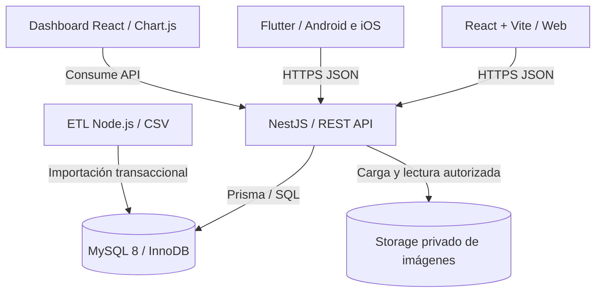
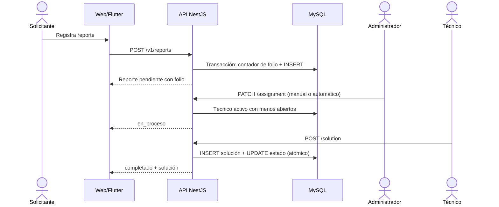

# Arquitectura — Banana Escolar

## 1. Vista de alto nivel



Web y móvil **nunca** se conectan a MySQL. La API centraliza autenticación,
autorización, validación, folios, asignación, transiciones y acceso a archivos.
El ETL es una tarea interna, no un endpoint público.

## 2. Monorepo

- `apps/web`: SPA feature-based (`auth`, `reports`, `dashboard`, `users`).
- `apps/api`: monolito modular NestJS con capas Controller → Use case →
  Repository port → adaptador Prisma.
- `apps/mobile`: Flutter con MVVM/repositorios; no es paquete pnpm.
- `packages/api-client`: contratos TypeScript y cliente HTTP compartidos.
- `tools/etl`, `tools/benchmark`: tareas Node independientes orquestadas por
  Turborepo.
- `infra`, `docs`: operación y evidencia.

### ¿Por qué monolito modular?

El volumen y el equipo no justifican microservicios. Un solo proceso reduce
complejidad operativa y mantiene transacciones simples sobre MySQL. Las fronteras
por módulo permiten extraer un servicio si las métricas reales lo exigen.

## 3. Flujo de una incidencia



## 4. Capas de la API

```text
reports/
├── reports.module.ts
├── presentation/      controller, DTO, mapper HTTP
├── application/       casos de uso y orquestación
├── domain/            reglas puras, tipos y puerto de repositorio
└── infrastructure/    adaptador Prisma/MySQL
```

- **Domain** no importa NestJS ni Prisma. Las reglas devuelven `{ok, reason}` y
  los casos de uso las traducen a errores HTTP.
- **Application** valida comandos, normaliza fechas y coordina transacciones.
- **Infrastructure** implementa consultas, folios y lecturas con joins.
- Los módulos `auth`, `users`, `categories`, `analytics` y `uploads` usan
  servicios más directos porque su lógica es principalmente de infraestructura.

## 5. Decisiones clave

| Decisión | Motivo | Consecuencia |
|---|---|---|
| MySQL + InnoDB | Requisito del proyecto; transacciones, FKs e índices B-tree | `FULLTEXT`, `EXPLAIN ANALYZE` y colaciones propias de MySQL |
| Prisma | Tipado, migraciones y productividad | SQL crudo para analítica y benchmark |
| Folio con contador transaccional | Evita colisiones y `COUNT(*)+1` | Tabla `folio_counters` por año |
| Solución + estado en una transacción | Invariante «completado ⇒ solución» | No se puede completar por PATCH de estado |
| Refresh token rotado y hasheado | Revocación y detección de reuso | Tabla `refresh_tokens` |
| Cookie `HttpOnly` en web + body en móvil | Reduce exposición de XSS en navegador | CORS con credenciales; almacenamiento seguro en Flutter |
| Imágenes fuera de MySQL | Binarios no inflan la BD ni los backups | Metadatos en `report_attachments`; descarga autorizada |
| Paginación offset en MVP | Coincide con la tarea académica | Cursor `creadoEn + id` como evolución para 1M |
| Datos sintéticos con semilla 2026 | Reproducibilidad y privacidad | Volúmenes exactos verificables |

## 6. Crecimiento y riesgos

### Escenarios

1. **1M de reportes**: el índice compuesto mantiene el historial filtrado en
   milisegundos; la paginación offset se degrada en páginas muy profundas, por lo
   que se recomienda cursor. La analítica por rango de fechas está acotada.
2. **Más escuelas**: hoy el modelo es de una institución. Añadir `escuela_id` a
   usuarios/reportes y un filtro obligatorio por escuela; evaluar partición.
3. **Búsqueda avanzada**: `LIKE` no escala con comodín inicial; FULLTEXT cubre
   términos. Para subcadenas masivas, motor externo en una fase posterior.
4. **Archivos**: el driver local no es apto para múltiples réplicas; migrar a S3
   antes de escalar horizontalmente.
5. **Reportes en tiempo real**: WebSockets/SSE quedan fuera del alcance; se puede
   añadir sin cambiar el modelo.

### Riesgos y mitigaciones

| Riesgo | Mitigación |
|---|---|
| Fuga de datos personales en CSV | Solo datos ficticios; `.gitignore` para CSV generados |
| Fotos públicas por error | Storage privado; descarga vía API con RBAC |
| Sesión robada | Access corto, refresh rotado, revocación por reuso |
| Folios duplicados bajo concurrencia | `upsert` + `increment` transaccional y `UNIQUE(folio)` |
| Reporte completado sin solución | Transacción única + unicidad `soluciones.reporte_id` |
| Benchmark mal interpretado | B1 y B2 se reportan como consultas no equivalentes |
| Índices que frenan escrituras | Medición de tamaño/tiempo y discusión de costo |

## 7. Despliegue sugerido

```text
Internet
  ├── CDN / hosting estático → dist de apps/web
  ├── Reverse proxy HTTPS → API NestJS (1 proceso, N réplicas)
  │      ├── MySQL administrado (réplica de lectura opcional)
  │      └── Bucket S3 privado para imágenes
  └── ETL/benchmark como jobs internos, jamás expuestos
```

Producción requiere HTTPS, secretos gestionados fuera del repo, backups,
retención de adjuntos, monitoreo y límites de subida.

## 8. MySQL vs MongoDB (entrega 1)

| Criterio | MySQL (elegido) | MongoDB |
|---|---|---|
| Modelo | Relacional con FKs, reportes↔soluciones 1:1, catálogos | Documental, útil si cada reporte fuera un documento autocontenido |
| Transacciones | Nativas y sencillas para folio + solución atómica | Transacciones multi-documento posibles pero con más disciplina |
| Consultas del proyecto | Filtros combinados, joins, agregaciones y paginación | Agregaciones potentes, joins con `$lookup` menos naturales |
| Integridad | UNIQUE, FKs, CHECK, ENUM | Validación en aplicación/esquema, integridad más flexible |
| Búsqueda | FULLTEXT; para subcadenas masivas se requiere motor externo | Atlas Search/text index; también requiere configuración |
| Reportes/BI | SQL estándar y herramientas maduras | Agregaciones expresivas, menor familiaridad SQL |
| Escala horizontal | Réplica/particionado; 1M es manejable | Sharding nativo, útil a escalas mucho mayores |
| Operación | Amplia experiencia del equipo y requisito académico | Curva y operación distintas |

**Conclusión:** el dominio es fuertemente relacional (usuarios, categorías,
reportes, soluciones, adjuntos) y las invariantes se benefician de FKs y
transacciones. MySQL es la mejor opción para este proyecto; MongoDB sería
razonable solo si se priorizara un documento único por reporte y sharding desde
el inicio. No se mezclan motores: MySQL es la única fuente de verdad.
