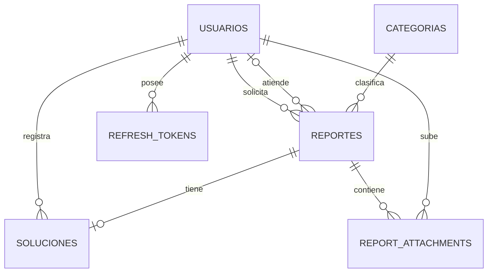

# Modelo de datos MySQL

Motor: **MySQL 8.0+** · Engine InnoDB · Charset `utf8mb4` ·
Collation `utf8mb4_0900_ai_ci` · Fechas en UTC (`DATETIME(3)`).

La migración inicial está en
`apps/api/prisma/migrations/20261030000000_init/migration.sql` y el esquema
Prisma en `apps/api/prisma/schema.prisma`.

## 1. Diagrama ER



## 2. Diccionario

### `usuarios`

| Campo | Tipo | Reglas |
|---|---|---|
| id | INT PK AUTO_INCREMENT | |
| nombre | VARCHAR(120) | obligatorio |
| correo | VARCHAR(190) | **UNIQUE**, login |
| password_hash | VARCHAR(255) | bcrypt 12 rondas, nunca se devuelve |
| rol | ENUM(`ADMIN`,`TECNICO`,`USUARIO`) | RBAC |
| activo | BOOLEAN | las cuentas inactivas no autentican |
| creado_en | DATETIME(3) | UTC |

Índice `idx_usuarios_rol_activo (rol, activo)`.

### `categorias`

| Campo | Tipo | Reglas |
|---|---|---|
| id | INT PK | |
| nombre | VARCHAR(100) | **UNIQUE** |

Catálogo de 7: Eléctrico, Plomería, Mobiliario, Pintura, Limpieza, Tecnología,
Seguridad.

### `reportes`

| Campo | Tipo | Reglas |
|---|---|---|
| id | INT PK | |
| folio | VARCHAR(20) | **UNIQUE**, `REP-AAAA-00001` |
| usuario_id | INT FK → usuarios | `RESTRICT` |
| categoria_id | INT FK → categorias | `RESTRICT` |
| tecnico_id | INT FK → usuarios | nullable, `SET NULL` |
| descripcion | TEXT | 10–2000 caracteres en API |
| ubicacion | VARCHAR(190) | obligatoria |
| prioridad | ENUM(`baja`,`media`,`alta`) | default media |
| estado | ENUM(`pendiente`,`en_proceso`,`completado`) | default pendiente |
| creado_en | DATETIME(3) | default now |
| asignado_en | DATETIME(3) | nullable |

Índices:

```sql
CREATE INDEX idx_reportes_cat_estado_fecha
  ON reportes (categoria_id, estado, creado_en DESC, id DESC);
CREATE INDEX idx_reportes_usuario_fecha
  ON reportes (usuario_id, creado_en DESC, id DESC);
CREATE INDEX idx_reportes_tecnico_estado
  ON reportes (tecnico_id, estado, creado_en DESC);
CREATE INDEX idx_reportes_estado_fecha
  ON reportes (estado, creado_en DESC);
CREATE INDEX idx_reportes_ubicacion ON reportes (ubicacion);
CREATE FULLTEXT INDEX idx_reportes_descripcion_fulltext ON reportes (descripcion);
```

### `soluciones`

| Campo | Tipo | Reglas |
|---|---|---|
| id | INT PK | |
| reporte_id | INT FK → reportes | **UNIQUE** (1:1), `CASCADE` |
| tecnico_id | INT FK → usuarios | `RESTRICT` |
| descripcion | TEXT | obligatoria, CHECK no vacía |
| observaciones | TEXT | nullable |
| resuelto_en | DATETIME(3) | servidor |

`UNIQUE(reporte_id)` impide dos soluciones para el mismo reporte.

### `report_attachments`

| Campo | Tipo | Reglas |
|---|---|---|
| id | INT PK | |
| reporte_id | INT FK → reportes | `CASCADE` |
| storage_key | VARCHAR(255) | **UNIQUE**, `reports/{id}/{uuid}.ext` |
| mime_type | VARCHAR(80) | JPEG/PNG/WebP |
| size_bytes | INT | ≤ 5 MB por defecto |
| uploaded_by | INT FK → usuarios | `RESTRICT` |
| created_at | DATETIME(3) | |

El MVP restringe una imagen por reporte desde la API; el modelo permite 1:N.

### `refresh_tokens`

| Campo | Tipo | Reglas |
|---|---|---|
| id | INT PK | |
| user_id | INT FK → usuarios | `CASCADE` |
| token_hash | CHAR(64) | **UNIQUE**, SHA-256 del JWT |
| expires_at | DATETIME | |
| revoked_at | DATETIME | null si activo |
| created_at | DATETIME | |

### `folio_counters`

| Campo | Tipo | Reglas |
|---|---|---|
| year | INT PK | |
| last_value | INT | contador por año |

La API hace `upsert` con `increment` dentro de la transacción de creación. El ETL
deja el contador por delante de los folios importados. No se usa `COUNT(*)+1`.

### `etl_runs`

| Campo | Tipo | Reglas |
|---|---|---|
| id | INT PK | |
| run_id | VARCHAR(64) UNIQUE | UUID de ejecución |
| started_at / finished_at | DATETIME(3) | |
| source_rows / inserted_rows / discarded_rows | INT | auditoría |
| checksum | CHAR(64) | SHA-256 del CSV |
| report_json | JSON | conteos, tiempos, Q1–Q3, entorno |

## 3. Invariantes

1. Todo reporte tiene solicitante y categoría existentes (FK).
2. `en_proceso` y `completado` requieren técnico asignado.
3. Completar exige solución en la **misma transacción**.
4. Solo el técnico asignado (o admin) resuelve; el técnico debe estar activo.
5. `UNIQUE(reporte_id)` evita soluciones duplicadas.
6. Estados y prioridades son listas cerradas por `ENUM` + validación API.
7. Transiciones permitidas: `pendiente → en_proceso`; completar únicamente con
   `POST /solution`.
8. Folio único y generado en servidor.
9. Un usuario ve solo sus reportes; un técnico solo los asignados.

La invariante 2 se valida en API y ETL, no con `CHECK`, porque MySQL rechaza una
restricción `CHECK` sobre `tecnico_id` cuando la FK usa `ON DELETE SET NULL`.
La 3 se garantiza con transacción; la 5 con índice único.

## 4. Tiempo y zona horaria

- La base guarda `DATETIME(3)` en UTC.
- La API serializa ISO 8601 (`...Z`).
- Web y móvil muestran hora local con `Intl`/`DateFormat`.
- Los CSV del ETL declaran y convierten a UTC antes de cargar.
- Las semanas del dashboard se calculan desde lunes UTC; documentar si se cambia
  a zona de Mérida para evitar ambigüedad en los cortes semanales.

## 5. Volumen de prueba

| Entidad | Filas |
|---|---:|
| Usuarios | 210 (2 admin, 8 técnicos, 200 solicitantes) |
| Categorías | 7 |
| Reportes | 10,000 |
| Soluciones | 8,099 |
| Descartados del CSV | 450 |

El benchmark usa una base separada `banana_benchmark` con 10,000 / 1,000,000
reportes y sin las FKs de la base funcional para aislar el costo de consulta.

## 6. Operación

```bash
pnpm db:deploy    # prisma migrate deploy
pnpm db:seed      # catálogos y cuentas demo
pnpm db:studio    # inspección local
```

`TRUNCATE` solo se ejecuta con `ETL_RESET=true` y `NODE_ENV!=production`. Nunca se
borra una base productiva desde el ETL.
